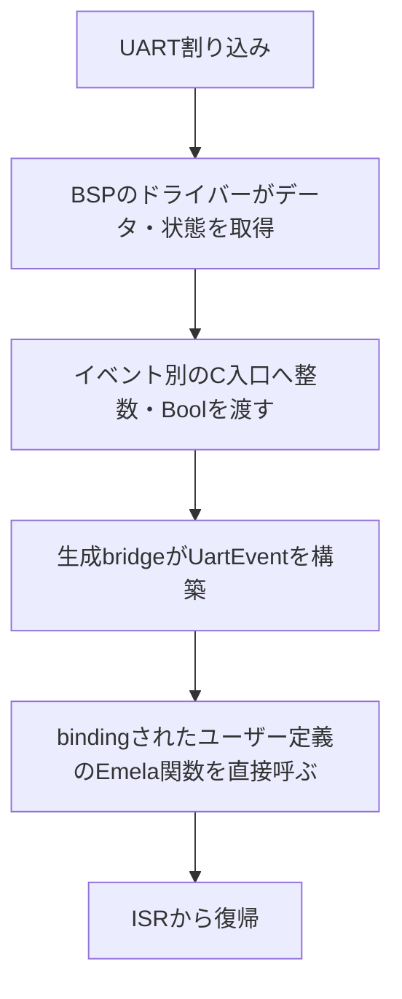

# UARTインターフェース仕様

状態：BSP実装に向けた操作契約と採用した実装計画。UART専用の`UartError`を採用する改訂APIを記載する。既存の3operationの入出力とC関数のシグネチャを維持し、公開エラー型とC statusの意味を更新する。受信ユーティリティと割り込み制御にはoperation・C入口を追加する。これらは現行stdlib・handler・BSPには未反映であり、以下の完了条件やtimeoutも準拠する実装への要求として扱う。

UART割り込みは[ハンドラーバインド方式](#割り込みとハンドラーバインド)を採用する。[受信方式](#受信方式の選択と排他)はUARTごとに通常受信か割り込み受信のどちらか一方とする。`receive_some`と受信破棄は[通常受信のユーティリティ](#通常受信のユーティリティ)として提供する。fiber連携とsuspendする送受信はUART APIの対象外とし、そのほかの将来のAPI拡張は[後続のAPI検討](#後続のapi検討)に別記する。

初期対応のBSPは[既存のSTM32F4とESP32-C3](#初期対応bsp)とする。

実行文脈、設定、期限、空の転送、容量、部分的な副作用、所有権は[共通の操作契約案](README.md)に従う。エラー型とstatusの対応は本書の[UARTエラー](#uartエラー)に従う。以下の`configure`・`transmit`・`receive`はmain文脈から呼ぶ同期operationであり、操作中にEmelaの別fiberへ制御を渡さない。割り込みからのユーザー関数の呼び出しは別の実行経路として扱う。

## Emela API

改訂対象の宣言元は[`Std.Embedded.Uart`](../../../emela-core/lib/std/embedded/uart.emel)、共有handlerは[`BoardUart`](../../../emela-core/lib/std/embedded/board.emel)である。以下は改訂後のAPIであり、`UartErrorKind`と`UartError`も`Std.Embedded.Uart`で定義する。

```emela
pub enum UartErrorKind {
  InvalidArgument,
  CapacityExceeded,
  NotConfigured,
  Unsupported,
  Timeout,
  Busy,
  ResourceConflict,
  InvalidState,
  Parity,
  Framing,
  Overrun,
  Other
}

pub error UartError(kind: UartErrorKind)

pub enum UartId { Uart0, Uart1, Uart2, Uart3, Uart4, Uart5, Uart6, Uart7 }
pub enum UartDataBits { Bits7, Bits8, Bits9 }
pub enum UartStopBits { Half, One, OneAndHalf, Two }
pub enum Parity { NoParity, Even, Odd }
pub enum UartDirection { Receive, Transmit, Both }
pub enum FlowControl { NoFlowControl, Rts, Cts, RtsCts }
pub enum Oversampling { By8, By16 }
pub type UartConfig(
  baud_rate: Int,
  data_bits: UartDataBits,
  stop_bits: UartStopBits,
  parity: Parity,
  direction: UartDirection,
  flow_control: FlowControl,
  oversampling: Oversampling
)

pub effect Uart {
  fn configure(id: UartId, config: UartConfig) -> () fails UartError
  fn transmit(id: UartId, data: List[Int], timeout_ms: Int64) -> () fails UartError
  fn receive(id: UartId, size: Int, timeout_ms: Int64) -> List[Int] fails UartError
}
```

## UARTエラー

エラーの種類と意味はEmela標準API側で定義する。UARTでは独立したエラー型`UartError`を返し、UARTに関係する分類だけを`UartErrorKind`に含める。共通化する単位は、ボード間でのUARTエラーの型と意味である。同じ機能・設定を提供するBSP間では、アプリのEmelaコードやエラー処理を変更せずに複数のボードへ対応できることを目指す。

| 分類 | 意味 |
| --- | --- |
| `InvalidArgument` | 不正なID、負のsize・timeout、データ幅を超える値等の不正な引数。 |
| `CapacityExceeded` | 転送bufferの容量や返却lengthの上限の超過。 |
| `NotConfigured` | 未設定、または再設定途中の失敗により未設定になったUARTへの転送。 |
| `Unsupported` | 対象BSPで対応していない設定・設定の組合せ・operation。 |
| `Timeout` | operation全体の待機期限の超過。CTS待機と送信完了待ちも含む。 |
| `Busy` | ほかの実行中操作との一時的な競合。許可されたmain送信と割り込み受信の併用は含めない。 |
| `ResourceConflict` | pin・controller・共有IRQ・Console等の予約・所有権競合。 |
| `InvalidState` | 割り込み受信中の通常受信、未bindingでの割り込み有効化、有効中の再設定、復旧前の再利用等。 |
| `Parity` | 受信データのparity異常。 |
| `Framing` | stop bitが期待する状態でない等のframe異常。 |
| `Overrun` | 受信FIFOやbufferのoverflow等による受信データの欠落。 |
| `Other` | 上記の共通分類に当てはまらないUARTの失敗。 |

細かい機種固有エラーは`Other`にまとめることを許容し、機種固有の詳細codeを公開APIで網羅することは要求しない。共通分類で表せるエラーは対応する分類へ変換する。ほかの周辺機器でも、`Timeout`・`Unsupported`等の同じ意味を持つ分類は意味を揃え、それぞれのAPIで必要なエラー型と分類を定義する。

各層の役割は次のとおりとする。

- Emela標準API：`UartErrorKind`と`UartError`、各分類の意味を定義する。
- BSP：HALのエラーをEmelaが定めたUARTの共通statusへ変換する。HAL固有のcodeをそのまま共通statusとして返さない。
- `BoardUart`：共通statusを`UartError(kind)`へ変換する。アプリは数値codeではなく`kind`で処理を分ける。

[共通の確定方針](README.md#確定した実装方針)に従い、ペリフェラルごとの専用エラー型を採用する。UARTの改訂APIには、本書の`UartError`を適用する。

## 設定とデータ表現

`UartId`は論理IDである。BSPがcontroller、TX/RX、RTS/CTS、clock sourceを定める。Consoleと物理UARTを共有する場合は、利用できる設定と競合の扱いも文書化する。アプリがUARTを再設定した結果、Consoleの設定を黙って壊す構成にしない。

| 設定 | 契約 |
| --- | --- |
| `baud_rate` | 正のbaud値。実現できる範囲・分周による誤差をBSPが定め、許容範囲外は拒否する。 |
| `data_bits` | parity bitを含まないデータ本体の幅。Bits7/Bits8/Bits9をそのまま下位HALのword lengthへ渡さず、parityとの組合せを変換する。 |
| `stop_bits` | stop bitの長さ。Half=0.5、One=1、OneAndHalf=1.5、Two=2 bit。非対応の長さを別の長さへ丸めない。 |
| `parity` | parityなし・偶数・奇数。送信時はBSPが生成し、受信時は検査する。parity bitをListの要素へ含めない。 |
| `direction` | Receiveは受信、Transmitは送信、Bothは両方を許可する。禁止された方向へのoperationは転送前に拒否する。 |
| `flow_control` | RTSは受信側の受入れ制御、CTSは送信側の待機制御。必要なpinと組合せをBSPが検証する。CTSによる待機も送信期限に含める。 |
| `oversampling` | 受信clockの8倍/16倍samplingの要求。選択できないBSPは非対応として拒否し、指定を無視しない。 |

各値がenumに存在しても、全BSPが全組合せを実装することは要求しない。例えばハードウェアが実現できない「データ9bit＋parity」は`configure`で拒否する。

stop bitの0.5・1.5は、1bitを送信する時間に対する長さの比率を表す。例えば1bitが100µsなら、`Half`は50µs、`OneAndHalf`は150µsのアイドル状態（通常はHigh）を保つ。一般的な電子工作では8N1（データ8bit・parityなし・stop bit 1）がよく使われ、通常は`One`を選ぶ。0.5・1.5にはスマートカード通信等の用途があり、STM32では通常モードとスマートカードモードで利用条件が異なるため、enumに値があるだけで通常UARTで使えるとはみなさない。

| データ幅 | ListとC配列の各要素 |
| --- | --- |
| `Bits7` | 0〜127 |
| `Bits8` | 0〜255 |
| `Bits9` | 0〜511 |

1要素が1つのUARTデータwordである。C配列は`uint16_t`を使い、幅を超える値をマスク・切り詰めない。受信結果ではデータ幅より上のbitを0にする。データの0や改行も通常の要素として保持し、文字列への変換、改行の追加、NUL終端、文字コードの処理は行わない。

## 受信方式の選択と排他

2026-10-23時点の決定として、受信方式はUARTごとに「通常受信」または「割り込み受信」のどちらか一方に限定する。同じUARTの受信データを、通常の`receive`と受信イベントへ二重に配送したり、両者が取り合ったりする構成にしない。別のUARTでは独立した受信方式を選べる。

| 受信方式 | 通常の`receive` | `Received`・`ReceiveError`イベント | main側からの`transmit` |
| --- | --- | --- | --- |
| 通常受信 | 使用する。受信異常は`UartError`で返す。 | 通知しない。 | 使用できる。 |
| 割り込み受信 | 使用できない。 | ハンドラーへ通知する。 | 使用できる。 |

いずれも`direction`で許可された方向に限る。排他にするのは受信経路であり、割り込み受信とmain側からの送信は併用できる。

割り込み受信を選択したUARTで通常の`receive`を呼ぶと、待機やデータ消費を始める前に`UartError(InvalidState)`を返す。FIFOから読み出したり、timeoutまで待ったりしない。size 0でもこの方式検証を省略しない。

受信方式は初期化時に選択し、初版では動作中の切り替えを提供しない。通信設定を再設定する場合も受信方式を維持する。割り込みの一時的な無効化を、通常受信への切り替えとして扱わない。開始・停止は[共通の状態遷移](README.md#状態遷移と通知の確定)と次節に従う。受信方式選択・有効化・停止の公開関数名と生成宣言はABI実装段階で確定する。

ハンドラーのbindingと受信方式の選択は別の意味とする。通常受信を使いながら、送信完了の`TransmitComplete`だけをbindingしたハンドラーへ通知できるようにする。ハンドラーがbindingされていることだけを理由に、受信方式を割り込み受信へ変更しない。

割り込み受信で取得した値を固定容量buffer等へ保存し、ほかの実行文脈から読む場合も、UARTからの読み出しは割り込み受信の経路に統一する。bufferの読み取りを、同じUARTへの通常の`receive`の呼び出しとは区別する。初版の受け渡しはUART APIとは独立した[固定容量・単一producer・単一consumerの共有API](README.md#isrの最小操作と情報共有)で扱う。mainでは取り出した値からList・Stringを構築して解析できる。

### 初期化と停止

割り込みを利用する場合は、設定、受信方式選択、実行時binding、割り込み有効化の順に準備する。生成C入口が存在するだけでは有効化を許可せず、`bind_interrupt`の実行時検証が成功していることを確認する。bindingなしでの有効化と割り込み有効中の再設定は`InvalidState`、競合する実行中転送は`Busy`とする。

停止はmainから行い、割り込み元とpendingを処理して、対象callbackと借用bufferの参照が終了してから返す。返却後に旧pendingからcallbackを呼ばず、再設定・再有効化では旧転送の完了を新しい転送として通知しない。既に停止済みなら成功する。通常受信と送信完了通知だけの併用、割り込み受信とmain送信の併用をそれぞれ維持する。

## operationの完了条件

### configure

設定とpin割り当てを固定資源表で検証してから適用する。成功後は指定方向と選択済みの受信方式に従って送受信できる。再設定は割り込みを停止してから行い、受信方式を維持する。既存の受信FIFOやエラーflagを保持・破棄する条件はBSPに記載する。検証失敗では設定と予約を維持し、ハードウェアの再設定途中で失敗した場合は共通の未設定・復旧状態へ移る。

### transmit

全要素を検証してから、Listの先頭から順に送信する。全wordの最終stop bitを送信し、送信回路の完了を確認して`()`を返す。FIFOへ格納できただけでは完了としない。

送信完了通知が有効なら、非空の成功した送信に対して`TransmitComplete`を1回呼び、callbackの終了後に同期`transmit`を成功として返す。完了IRQとtimeoutが別々の結果を返さないよう、転送結果を一度だけ確定する。空送信と失敗した送信には`TransmitComplete`を通知しない。

通信相手が受信・処理したことは保証しない。UARTの標準operationにACK・再送・メッセージ境界は設けない。プロトコル上のACKが必要なら、アプリや上位ライブラリが送受信で実装する。

### receive

通常受信を選択したUARTに対して使用する。割り込み受信との排他と、禁止された呼び出しの扱いは[受信方式の契約](#受信方式の選択と排他)に従う。

指定した`size`個のデータwordを到着順に消費して返す。read開始時にFIFOにあるデータも対象にし、転送開始だけを理由に破棄しない。sizeを超える後続データは次の受信の対象に残す。保持できる量とoverflowの扱いはBSPに記載する。

改行やidleを終了条件にせず、要求数を全て受信して成功する。期限切れやparity/frame/overrun等の異常では対応する分類の`UartError`を返し、部分的なListを成功として返さない。途中まで消費した入力は元に戻らない。

## timeoutと失敗後の状態

共通の期限契約に従い、timeoutは全wordと送信完了待ちに共通である。byteごと、CTS待機ごとに期限を延長しない。空の送信とsize 0は検証後に通信せず成功する。

`timeout_ms == 0`の非空送信は、新たな通信と完了待ちが必要なため開始前に`Timeout`を返す。固定長受信は既に保持されている要求数を待機せず取得できると確認した場合だけ消費し、不足時は消費せず`Timeout`を返す。`receive_some`では保持済みの1word以上を上限まで返せる。

送信途中で失敗した場合、送信済みwordは取り消せない。BSPは返却時に入力配列の参照を終え、残りのwordを配列から送り続けない。失敗時点でshift registerに入っているwordの完了または停止方法をBSPに記載する。

無効な設定、未設定、非対応、timeout、parity/frame/overrun等は[UARTエラー](#uartエラー)の分類へ変換する。BSPはHALエラーから共通statusへの対応を文書化する。改訂後は-1/-2をBSPからも返せる共通statusとし、`BoardUart`でそれぞれ`InvalidArgument`・`CapacityExceeded`へ変換する。受信エラー後にどのFIFOやflagをclearするかも文書化し、次の受信で同じ異常を無期限に待たない。

## 割り込みとハンドラーバインド

2026-10-23時点の採用方針として、マイコンのドライバーの割り込みハンドラーから、ユーザーが定義したEmela関数を直接呼ぶ方式とする。bindingはビルド時に確定し、生成Cの直接呼び出しへ接続する。ユーザー関数はISR文脈で実行し、呼び出すまでにmain側のqueueやfiber schedulerを経由しない。

本節のハンドラーは、割り込みから呼ばれるユーザー関数を指す。effectの操作を実装する共有handlerの`BoardUart`とは役割を分ける。2026-10-23時点の決定として、利用者は`bind_interrupt`でUART IDと1つのユーザー関数を対応付け、その関数で`UartEvent`を受け取る構成を採用する。BSP向けC入口はイベント別の整数・Bool引数とし、生成bridgeがイベントを構築してユーザー関数を直接呼ぶ。これらの接続は未実装であり、`IsrSafe`等の制約の具体化と、受信方式選択・割り込み有効化のAPIは引き続き実装設計で定める。



### ドライバーとユーザー関数の役割

- ドライバーはIRQ vectorへの接続、受信データ・状態の取得、割り込み原因の処理、機種固有エラーの変換を担当する。flagのclearや読み出しの順序は対象マイコンの規則に従う。
- bindingは論理UART IDとユーザー関数を対応付け、対象の割り込みを有効にする前に確定する。実行時の動的な関数登録や差し替えは、この方式の初期対象に含めない。
- ユーザー関数には、ドライバーが取得した受信データや共通分類のエラー等を渡す。受信値は設定した7/8/9bit幅に従い、ユーザーコードに機種固有のレジスタ操作を要求しない。
- UARTからのデータ読み出しはドライバー側に統一する。ユーザー関数が同じ受信レジスタを重ねて読み出す構成にしない。通常の`receive`と割り込み受信は[UARTごとに排他](#受信方式の選択と排他)とし、ハンドラーのbindingと受信方式の選択は分ける。

通知する事象には、受信データの到着、最後のstop bitまでの送信完了、受信エラーを想定する。割り込みのエラー通知は、`UartErrorKind`と意味を揃えた受信異常の分類を使い、細かい機種固有エラーは`Other`へ変換する。

### 割り込み優先度

2026-10-23時点の決定として、利用者が指定する割り込み優先度は次の3段階とする。順序は`High > Normal > Low`であり、Emelaのenumの内部値をハードウェアの優先度へ直接渡さない。

```emela
pub enum InterruptPriority { Low, Normal, High }
```

優先度は同じcore上の通常IRQの関係を表す。BSPが、ユーザーの生成C関数をISRとして呼び出せるハードウェア・SDKの優先度へ対応付ける。`High`をマイコンの最高優先度やNMIへ自動的に対応させず、システム用IRQや共有IRQとの関係もBSPに文書化する。3段階の優先関係を実現できない指定は`UartError(UartErrorKind.Unsupported)`で拒否し、異なる段階を黙って同じ優先度へ丸めない。

Emelaが管理する通常IRQでは、実行中のISRへ同じ優先度または低い優先度のISRをネストさせない。それらの要求は、その時点で実行せずpendingとして扱う。UARTのデータや状態の保持は別途ハードウェア・ドライバーが担当し、pendingがイベント発生回数を無制限に保存することは意味しない。

高優先度ISRが低優先度ISRの途中へ入るネストの保証範囲は、開始・停止とBSPのISR入口の設計で別途確定する。割り込み禁止中は高優先度でも待機するため、優先度設定だけで応答期限を保証しない。NMI・fault等の例外や別coreの実行は、この3段階の通常IRQの契約とは別に扱う。

Cortex-M系ではNVICが優先度に応じたネストを管理する。STM32でpreemption priorityとsubpriorityを分ける構成では、3段階の割り込み関係をpreemption priority側へ対応付ける。ESP32-C3では、優先度・しきい値に加えて、ISR入口でのコンテキスト保存と割り込み再有効化等のソフトウェア対応が必要である。割り込みを再有効化する場合も、同じ優先度以下が実行中のISRへ入らないようにする。

優先度を指定する関数、初期値、設定可能な時点とIRQ単位への対応は、割り込みの有効化・無効化のAPI設計で具体化する。

### binding専用関数

専用関数は`bind_interrupt`とし、callbackにはUART IDとイベントを渡す。同じユーザー関数を複数のUARTへbindingできる。署名は次の形を基準とし、`IsrSafe`制約の具体的な表現は実装設計で定める。

```emela
fn bind_interrupt[R: IsrSafe](
  id: UartId,
  handler: fn(UartId, UartEvent) -> () fails {} use R
) -> () fails UartError
```

`IsrSafe`は新設するコンパイラー検査付きの制約であり、現行言語には未実装である。既存のeffect集合への制約の仕組みに合わせ、ISR用に許可したoperationとhandlerだけを使えることを表す。利用者の宣言だけで安全性を付与せず、具体化した呼び先まで検査する。詳細は[effectによるISR制約の案](#effectによるisr制約の案)に記載する。関数引数の型で`fails`・`use`を省略すると、それらを空に限定する意味にはならないため、`fails {}`と`use R`を明記する。

bindingは初期化時にmain文脈から行い、handlerは同期・`fails`なしの関数とする。ISR内での直接呼び出しを維持するため、UART IDとhandlerはコンパイル時に特定できることを必須とし、handlerにはcaptureのない名前付き関数を渡す。backendが対応を解析し、ISR検査とドライバーからの直接呼び出しを生成する。ISRに必要な能力は、[BSPが提供するISR専用handlerを静的に接続する方式](#bspによるisr専用handlerの静的供給)で供給する。通常の関数値をC関数pointerへ自動変換する機能は現行backendにはなく、この接続は追加実装となる。

binding時の不正な設定や非対応の要求は`UartError`としてmain側へ返す。型・静的binding・ISR制約の違反はコンパイル時に診断する。受信方式の選択、割り込みの有効化・無効化は、このインターフェースと[受信方式の排他方針](#受信方式の選択と排他)に合わせて別途具体化する。生成Cの公開入口は[イベント別の基本型引数](#割り込みイベントのc入口)とする。

### 採用した利用者向けインターフェース

利用者は、captureのない名前付き関数を定義し、初期化時にUARTへbindingする。C側のイベント別入口の定義や、EmelaのenumのCレイアウトを利用者へ要求しない。名前をimport済みとした利用例は次のとおりである。これは改訂後の利用方法を示す例であり、現行stdlibで実行できるコードではない。

```emela
fn on_uart(id: UartId, event: UartEvent) -> () fails {} use {} {
  event match {
    Received(value) -> {
      # value: 受信した1word
      ()
    }
    TransmitComplete -> {
      # 最後のstop bitまで送信完了
      ()
    }
    ReceiveError(errors) -> {
      # errors.parity / framing / overrun / other
      # 複数の異常が同時に入ることがある
      ()
    }
  }
}

fn initialize() -> () fails UartError {
  # UARTの設定と受信方式の選択
  bind_interrupt(Uart1, on_uart)
  # 準備完了後に割り込みを有効化
}
```

`on_uart`はISR文脈で実行する。例はeffectを使わない関数だが、GPIO等を操作する場合は許可されたeffectを`use`へ宣言し、BSP提供のISR専用handlerへ静的に接続する。関数の外へ失敗を伝播させず、heap・参照管理・待機等の禁止を適用する。UARTの設定、受信方式選択、割り込み有効化はbindingと別の初期化操作であり、上のコメントはそのAPIを確定するものではない。

### BSPによるISR専用handlerの静的供給

2026-10-23時点の決定として、初版ではBSPが提供するISR専用handlerを静的に接続し、その資源と能力の有効期間を割り込みの有効期間に対応付ける。このhandlerは、ユーザーの割り込み関数の中で使うeffect操作の具体的な実装を指す。`IsrSafe`は許可条件を表す制約であり、handlerの実体と資源はBSPが提供する。

- BSPは、ISR用に許可されたeffectに対応するhandlerと、使用するUART・pin・固定領域等の資源を定める。backendはbinding先のeffect集合`R`をその実装へ静的に解決し、ISR内の操作を生成Cの直接呼び出しへ接続する。
- 静的に解決できないeffect、未許可のhandler、fiber側で供給された通常のhandlerや能力をISRへ持ち込む構成はコンパイル時に拒否する。実行時のhandler選択・差し替えや、fiberの実行文脈からの能力の借用は初版では提供しない。
- BSPは必要な保存領域を固定領域に置き、資源の割り当て・初期化と接続をmain側で完了してから割り込みを有効にする。ISR内でhandlerや保存領域を生成・確保せず、既に準備された資源だけを使う。
- 資源は割り込みの有効期間を通じて保持する。停止・再設定・再利用では、対象の割り込み元を無効にしてpending状態を適切に処理し、実行中のISRがその資源へのアクセスを終えたことを確認してから能力を無効化・再初期化する。割り込み許可bitを落としたことだけで資源を再利用してよいとはみなさない。

固定領域の物理的な保存期間はプログラム全体でもよい。能力を利用できる期間と、実行中のISRのために資源を保持する期間を明確にする。UARTごとに独立させる領域と、複数のbindingで共有する資源の対応はBSPが定め、共有する場合はISRのネストや再入を含めて競合を防ぐ。fiberとの情報共有は、既存の[状態分離の方針](#fiberとisrの状態の分離)に従う。

ISR専用handlerが提供する操作は、即時完了する短い有界な処理に限定し、既存のeffect・heap・待機禁止の制約を適用する。通常のアプリの進行、待機や複雑な処理の組み立てはfiber側で行う。UARTがユーザーの割り込み関数をmain側へ自動配送する仕組みは追加しない。

この静的供給方式は採用する設計方針であり、BSPの対応定義、backendでの解決と直接呼び出し、資源の有効期間の管理は未実装である。初期BSPで提供するISR用effect・操作の具体名とC ABIは実装時に確定する。

### bindingの一意性と関数の再利用

2026-10-23時点の決定として、1つのUARTには1つの静的bindingだけを許可する。同一プログラム内の別モジュールや別関数に記述されたbindingも含め、解決後のUART IDが同じなら重複としてコンパイルエラーにする。同じhandlerへの二重bindingも許可せず、後からの上書きや同一指定の再登録として扱わない。条件分岐で一方だけが実行されることを理由に、同じUARTへの複数のbindingを許可しない。

UART IDまたは呼び出すhandlerをコンパイル時に特定できない場合も、必ずコンパイルエラーにする。実行時の関数選択や登録へ切り替えるfallbackは設けない。

同じユーザー関数を異なるUARTへbindingすることは許可する。各UART向けの呼び出し口とbindingを独立して生成し、同じ関数から複数のUARTへの接続を作れるようにする。

```emela
bind_interrupt(Uart0, on_uart)
bind_interrupt(Uart1, on_uart)
```

この例では、UART0の呼び出し口は`on_uart`へ`Uart0`を渡し、UART1の呼び出し口は`Uart1`を渡す。関数本体の機械語を共有するかUARTごとに展開するかは生成時の実装・最適化に委ねる。同じ関数を使うbindingの複製は、その関数が参照する共有状態を自動で複製することを意味しない。UARTごとの状態が必要な場合は、渡されたUART IDに対応する保存領域を使う。

| bindingの指定 | 結果 |
| --- | --- |
| 異なるUARTへ同じ関数をbinding | 許可。UARTごとに独立したbindingを生成する。 |
| 同じUARTへ同じ関数を二重にbinding | コンパイルエラー。 |
| 同じUARTへ異なる関数をbinding | コンパイルエラー。 |
| UART IDまたはhandlerを静的に特定できないbinding | コンパイルエラー。 |

### 静的bindingのコンパイラー実装計画

2026-10-23時点の採用方針として、bindingの収集、接続先の確定、プログラム全体の重複検査、関数の保持とISR検査、C入口の生成、BSPからの接続を一連の処理として実装する。この接続は未実装である。GPIO・I²Cの静的bindingにも同じ処理を適用し、対象IDとイベントの契約は各仕様に従う。

#### bindingの収集と解決

型検査後の名前解決済みコードから、標準のbinding関数への指定を収集する。同じ名前を持つ利用者独自の関数と混同しない。単相化・定数解決を経て接続先を確定し、bindingの指定や関数参照を消す最適化より前に、次の情報を保持する。Core・Flow間の変換でも定義と具体化後の関数の対応を引き継ぐ。

| 情報 | 用途 |
| --- | --- |
| ペリフェラルの種類と解決済みの論理ID | UART0等の接続先の識別と重複検査。enumの内部整数値や物理controller番号で代用しない。 |
| ユーザー関数の定義と具体化後の関数ID | 生成対象としての保持、ISR検査、直接呼び出し。 |
| 解決したISR専用handlerと資源の対応 | effect操作の静的接続と、bindingごとの資源の確認。 |
| binding指定のソース位置 | 解決失敗や重複の診断。重複時は両方の指定箇所を示す。 |

初版では、IDの直接指定に加え、定数・不変なローカル別名を辿って同じIDへ一意に解決できる指定を許可する。ユーザー関数はcaptureのない名前付き関数とし、importによる別名も同じ定義へ解決する。実行時の入力・可変状態・実行時の関数選択が必要な指定はコンパイルエラーにする。任意の補助関数を評価して接続先を推測することや、動的な登録へ切り替えることは要求しない。

```emela
# 名前をimport済みとした、改訂後の指定例
bind_interrupt(Uart0, on_uart)

# 別名を使っても、解決結果は同じUART0
id = Uart0
bind_interrupt(id, on_debug)
# 上の指定と重複するためコンパイルエラー
```

ビルド対象のプログラム全体で、解決したペリフェラルの種類と論理IDをkeyに重複を検査する。別モジュール・別関数・別名を経由した指定も照合し、条件分岐の片方だけが実行されることを理由に重複を許可しない。重複検査は指定箇所に基づいて行い、最適化によるコード削除・複製で判定が変わらないようにする。同じ関数を異なるIDへbindingする指定は、それぞれ独立した接続として保持する。

#### 関数の保持とISR検査の自動適用

binding先を、通常のEmelaコードから直接呼ばれなくても生成する入口として扱い、その関数と到達する呼び先・handlerを保持する。binding指定をコンパイル時情報へ置き換えた際に関数参照まで消えても、不要コードとして除去しない。保持はC生成時だけでなく、先行する単相化・lowering・到達性の解析でも維持する。

現行の[`validate_isr_entries`](../../src/emit.rs)は、`with_isr_entry`で明示された、生成対象のexport済み関数を検査する。改訂では、解決した関数IDからbinding先とISR専用handlerへ検査を自動適用する経路を追加する。利用者に`pub`指定やRust側の`with_isr_entry`の追加を要求しない。既存の明示指定による検査も維持する。

effect・handlerの許可判定と、heap・参照管理・再帰・suspend・Clock系effect・待機等の検査を組み合わせる。ユーザー関数の本体だけでなく、具体化した呼び先まで確認し、通常のhandlerを経由して禁止操作を隠す指定も拒否する。

#### C入口の生成とBSPからの接続

各bindingについて、[イベント別のC入口](#割り込みイベントのc入口)の宣言と実装を生成する。BSPが基本型引数を渡すと、生成bridgeは固定サイズのイベントを構築し、bindingに対応する論理IDを補ってユーザー関数を直接呼ぶ。同じ関数をUART0・UART1へbindingした場合も、入口ごとに正しいIDを渡す。

例えばUART0の受信入口は、次のような接続になる。symbol名とイベント構築helperは説明用であり、正式な宣言は生成headerで定める。

```c
void emela_uart0_received(int32_t value) {
    generated_on_uart(EMELA_UART_ID_UART0, make_received(value));
}
```

BSPは論理IDと物理controller・IRQの対応に従い、データ取得と割り込み原因の処理を行ってから、この生成入口をISR内で呼ぶ。Emelaの関数値やイベントの内部レイアウトをBSPへ公開しない。C入口からユーザー関数までの呼び出しにqueueやschedulerを挟まない。

接続先をビルド時に確定することと、main側での資源準備・設定検証は分ける。bindingの指定から関数pointerの動的登録を生成せず、実行時に必要な初期化や`UartError`を返す検証をコンパイル時の接続情報への置換で消さない。割り込みの有効化は、実行時の`bind_interrupt`と必要な初期化が成功した後に行う。実行されない分岐にbindingの記述があるだけでは、有効化の前提を満たさない。

#### 実装時の確認項目

| 試験 | 確認内容 |
| --- | --- |
| 解決と診断 | 直接指定・不変なID別名・importした関数名の解決、動的なID・関数選択・captureの拒否、診断のソース位置。 |
| 重複検査 | 別モジュール・別関数・条件分岐・別名経由の同一IDの拒否、同じ関数を異なるIDへbindingする指定の許可、最適化前後での判定の維持。 |
| 関数の保持とISR検査 | privateかつ通常呼び出しのないbinding先と補助関数の保持、既存の明示ISR指定の維持、禁止操作への直接・間接の到達の拒否。 |
| 生成CとBSP接続 | host C mockから各イベント入口を呼び、正しいID・イベント・ユーザー関数への直接呼び出しとheap不使用を確認する。実IRQ文脈からの呼び出しはBSPのモデルまたは実機で別途確認する。 |
| 初期化 | 接続を静的生成しても実行時の設定検証と失敗が保持され、必要な資源の準備前に割り込みを有効にしないこと。 |

### イベント型

2026-10-23時点の決定として、`UartEvent`は、値を受け取ったこと、送信が物理的に完了したこと、受信異常の3種類を表す次の形を採用する。受信異常は複数種類を1イベントに含められる固定サイズの集合で渡す。この型とbindingへの接続は未実装である。

```emela
pub type UartReceiveErrors(
  parity: Bool,
  framing: Bool,
  overrun: Bool,
  other: Bool
)

pub enum UartEvent {
  Received(value: Int)
  TransmitComplete
  ReceiveError(errors: UartReceiveErrors)
}
```

| イベント | 意味 |
| --- | --- |
| `Received(value)` | ドライバーが読み出した1wordを渡す。データ幅はUARTの設定に従い、7/8/9bitを`Int`で表す。データがあることだけを通知してユーザーに読み出させる方式にはしない。 |
| `TransmitComplete` | 1回の送信操作の全wordについて、最後のstop bitまで送信したことを通知する。送信FIFOの空きや、送信bufferを回路へ渡し終えたこととは区別する。 |
| `ReceiveError(errors)` | BSPがその時点で取得できた受信異常の集合を通知する。parity・frame・overrun等を複数同時に含められる。設定ミス、非対応要求、operationの待機期限切れ等のAPI呼び出しの失敗は含めない。 |

イベントは`Int`・`Bool`・固定サイズの値型とenumで構成し、ISR内でheapや参照管理を必要とするList・String・所有bufferを渡さない。1回の割り込みで複数wordを取り出した場合は、到着順に`Received`を複数回通知できる。割り込み1回とイベント1個の対応は保証しない。

`UartReceiveErrors`は、割り込み中に検出する受信異常に絞った型とする。`parity`・`framing`・`overrun`・`other`の意味は、それぞれ`UartErrorKind`の`Parity`・`Framing`・`Overrun`・`Other`と揃える。同期の失敗型`UartError`と、ISRへ渡すイベントを分け、`InvalidArgument`や`NotConfigured`等を受信イベントとして表せないようにする。

例えばparity異常とframe異常を同じ観測で取得できた場合は、`parity`と`framing`を両方`true`にした1回の`ReceiveError`で通知する。優先順位でどちらかを捨てたり、HAL内部のチェック順に種類ごとのイベントへ分解したりしない。`ReceiveError`では最低1つのfieldを`true`とし、全fieldが`false`の空のエラー集合をBSPから通知しない。

共通分類で表せる異常は対応するfieldを`true`にし、分類できない受信異常は`other`を`true`にする。既知の異常と未分類の異常を同じ観測で取得した場合は、既知のfieldと`other`を両方保持する。HAL固有のbit値やcodeを公開APIへそのまま渡さない。

集合はBSPが取得できた観測結果を表し、エラー同士の発生順、発生回数、すべてが同じwordに対応することは保証しない。HALやハードウェアが情報を分割して通知する場合もあるため、同時発生したすべての異常が全BSPで必ず1イベントにまとまることまでは要求しない。分割された観測は個別の`ReceiveError`として通知でき、集合を完成させるために後続の異常を待たない。

初期案では、検出されたparity/frame異常のあるwordを通常の`Received`として通知しない。該当する異常を`ReceiveError(errors)`で通知し、受信値の破棄・FIFOの復旧条件はBSPに文書化する。`overrun = true`は受信データの欠落があったことを示し、欠落した個数や正確な位置は保証しない。受信データとエラー集合、送信完了イベントとの相対的な通知順序や復旧条件は、引き続き別途具体化する。

`TransmitComplete`は、通知が有効な非空の送信操作の成功に対応して1回通知し、callback終了後に同期operationから返す。初期状態で送信回路が空いているだけでは通知しない。空の送信や、途中失敗した送信の末尾が回路から出たことだけを理由に通知しない。送信失敗は同期operationの`UartError`で扱い、完了IRQとtimeoutで異なる結果を確定しない。

idle検出、break検出、CTSの変化、DMAのbuffer単位の通知等は拡張候補とする。idle検出はデータ間の空き時間の通知であり、operation全体の期限切れを表す`Timeout`とは分ける。DMA等で複数wordをまとめて渡す場合は、bufferの寿命・所有権を定めた別の契約を設計する。

### fiberとISRの状態の分離

2026-10-23時点の決定として、fiberとISRが通常の可変状態へ競合してアクセスできない設計とする。ISRからfiber所有のローカルな状態、`State`・Cell、handlerの保持する可変状態へ直接アクセスさせない。不変な値のコピーは許可する。

情報の受け渡しには、UART APIから独立した[固定容量の共有API](README.md#isrの最小操作と情報共有)を使う。初版は単一producer・単一consumerとし、満杯なら即座に失敗を返して欠落を観測できるようにする。通常の可変状態への参照をISRへ渡さず、ISR側はfiberの実行やlock解放を待たない。保存した値はmain側で取り出してList・String等による解析へ渡し、共有APIからfiberを自動再開しない。

### effectによるISR制約の案

effectを使って、ISRから利用可能な操作を型の上で制限する。fiberやClock等の禁止リストに加え、compiler・stdlibがISR用に認めたoperationとhandlerを明示的に許可する。初版はGPIOのread/writeと固定容量の共有操作を、[BSPによる静的供給](#bspによるisr専用handlerの静的供給)で接続する。利用者が任意のeffectやhandlerを宣言するだけで、ISR安全と扱われる仕組みにはしない。

| 対象 | 方針案 |
| --- | --- |
| fiber操作、`Async`、suspendする操作 | ISRから利用不可。 |
| 既存の`Clock` | `sleep`・`now`とも利用不可。BSP内部のdeadline管理はユーザーISRの操作と分ける。 |
| fiber側の`State`・Cell・通常のhandler能力 | ISRへ持ち込めない。 |
| 通常の同期UART・GPIO・Console等 | そのままISR安全とみなさない。必要な操作を、ISR用のeffect・handlerとして個別に設計・検査する。 |
| ISR用のI/O、状態保存、受け渡し | 初版はGPIO read/writeと固定容量の共有操作。configure・toggle・割り込み設定は許可しない。同じeffect内でもoperationごとに検査する。 |

既存の`Immediate`制約は「中断せず、その場で完了する」ことだけを表す。同期の`State`も対象になりうるため、fiberとの状態分離やISR安全性の証明にはならない。

関数の外から見えるeffect集合の検査だけでは十分でない。例えば`State.run`は`State`を内側で処理して外側の集合から除去でき、純粋なList生成もheapを使いうる。具体化した呼び先・handlerの実装を含む到達検査と、heap・参照管理・suspend等への既存ISR検査を組み合わせる。effect操作を生成Cの直接呼び出しへ解決する接続も追加実装が必要である。

effect名が分かれていても、同じ状態やUART・pin等の資源を競合して操作すれば問題は残る。binding時の資源の対応付けと、許可する操作の組合せも検査対象にする。外部Cの実装はcompilerから検証できないため、BSPがISR安全性・共有資源の契約を満たす信頼境界として扱う。

### heap利用の禁止

2026-10-23時点の決定として、ISRにはeffect制約とheap不使用の両方を要求する。`IsrSafe`等で許可されたeffectだけを使っていても、heap利用の検査を通過しなければコンパイルエラーにする。

effectを使わない純粋な処理でも、動的なList生成等はheapを必要とする。例えば次の関数にはeffect操作がなくても、Listのnodeを生成する処理があるためISRからの利用を拒否する。

```emela
fn wrap(value: Int) -> List[Int] {
  [value]
}
```

検査では、heap確保に加えてheap値の参照管理・解放も禁止対象にする。

| 対象 | 方針 |
| --- | --- |
| heap確保 | heapを必要とするList生成、文字列連結、closure生成等を拒否する。 |
| heap値の参照管理・解放 | 参照カウントの更新、heap値の保持・解放等、共有runtimeの所有権管理をISRから行う処理を拒否する。 |
| heapに依存しない値 | 数値、固定サイズのenum等は、ほかのISR制約も満たす範囲で利用できる。 |

bindingされた関数の本体だけでなく、静的に解決した呼び先・handlerの具体的な実装まで辿って検査する。外から見えるeffect集合が空であることや、handlerがeffectを内側で処理することを理由にheap検査を省略しない。

実装では、`with_isr_entry`に使われている既存のheap・heap参照の到達検査を土台にする。UARTのbinding先へこの検査を自動適用し、effect・handlerの許可判定および静的な直接呼び出しへの解決と組み合わせる接続を追加する。既存検査があることと、UARTのbindingから自動適用されることは分けて扱う。

main側に文字列付きエラーが存在しても、ISR内の固定サイズ`GpioError`の捕捉はheap不使用で実行できるようにする。module全体のmanaged error payloadから判定する現行処理は、到達する失敗型・handlerに基づく判定と必要な特殊化へ改める。[共通の実装条件](README.md#isrの最小操作と情報共有)に従い、mainのList・String・`fails`とISRのエラー捕捉が共存するソースを試験する。

外部C関数の内部はcompilerから検証できないため、ISR安全な外部関数にもheap確保・参照管理・解放を行わず、待機しない契約を要求する。`with_isr_safe_external`の指定はその実装を証明するものではなく、BSP側が契約を満たす責任を持つ。

### ISR内の制約と共有データ

ユーザー関数とその到達先には、[既存のISR安全性検査](../implementation.md#4-外部cisrボードとの境界)を適用する。`with_isr_entry`は入口の検査を指定する既存機能であり、UARTの割り込みとのbindingやIRQ vectorへの接続は追加の実装となる。同じ関数を異なるUARTへbindingした場合、その関数が高優先度のUARTから再入する可能性も考慮して共有状態を扱う。

ISRから利用する操作は、待機せず即時に完了するものだけを許可する方針とする。ここでの即時完了とは、時間の経過、通信やデバイスの準備・完了、lockの解放、ほかのfiberの実行等を待たずに、短い有界な処理で戻ることを指す。実行時間が0であることや、ISR全体の実行時間の上限を自動で保証することは意味しない。

Clock系effectはISRから利用しない。[`Std.Clock.Clock`](../../../emela-core/lib/std/clock.emel)の`sleep`に加え、待機しない時刻取得の`now`も禁止対象とする。ユーザー関数から直接呼ぶ場合だけでなく、通常の関数やhandlerを経由して到達する場合もコンパイル時に拒否する。この追加検査は今後の実装対象である。

| 操作 | ISRでの方針 |
| --- | --- |
| 数値演算、分岐等 | heapを使わず、短い有界な処理として実行する。 |
| GPIO read/write、固定容量の共有操作 | ISR専用handlerへ接続する。共有操作内部のatomic操作または短いcritical sectionで排他・可視性を保証する。 |
| Clock系effect | `sleep`・`now`を含めて禁止する。時刻取得だけの利用も許可しない。 |
| 完了・空き・lock等を待つ操作 | 同期呼び出しであっても禁止する。busy waitや時間待ちを目的としたループも含む。 |

禁止するeffectや操作の由来は、handlerの静的解決やCへの変換後も検査できるようにする。既知のClock実装をISR安全な外部関数として指定することで、禁止を迂回できる構成にはしない。`Instant`・`Duration`等の値に対する、時刻取得や待機を伴わない純粋な計算はClock系effectの禁止対象に含めず、一般のISR制約で扱う。

- heapを使うList生成・参照管理・再帰・suspend・動的call等、既存検査で禁止された処理をISRから呼ばない。
- 外部C関数は`with_isr_safe_external`等でISR安全性を明示し、待機せず即時に完了し、Clock系effectに相当する処理を行わない契約を持つものを使う。既存の同期`configure`・`transmit`・`receive`はISRから呼ばない。ISRから送受信操作を行うための専用操作が必要なら、即時完了の条件を満たす契約として別途設計する。
- 受信データを後で利用する場合は、固定容量buffer等の保存先とoverflowの扱いを定める。受信データの欠落は`Overrun`として扱う。Emela本体に汎用の受信bufferや全通知のqueueを必須機能として組み込むことは、この直接呼び出し方式の前提にしない。
- ISRとfiberの情報共有は、[状態分離の方針](#fiberとisrの状態の分離)に従い、競合を防ぐ専用の型・操作を通す。通常の可変状態への直接アクセスを許可しない。専用操作の内部ではatomic操作や短い割り込み禁止区間等による排他・可視性の規則を定める。

ISR安全性検査は、外部C関数の実装、実行時間の上限、共有データの競合がないことを証明するものではない。ユーザー関数は短時間で完了するように設計する。

### fiberとの役割分担と時間の目安

| 担当 | 主な役割 |
| --- | --- |
| fiber | 通信内容の解析、表示、ログ、待機を含むアプリの進行等、時間に余裕のある並行処理。 |
| 割り込み | データの取り込み、送信完了処理、即応性が必要で短時間に完了する処理。 |
| タイマー・PWM・DMA等のハードウェア | 正確な周期や波形、大量データの転送等。 |

2026-10-23時点の決定として、fiberとISRは異なる役割を持つものとして扱い、UART APIにはfiberの起動・再開・待機、suspendする送受信、ISRからfiberへの自動配送を含めない。UARTが提供するのは、同期の送受信、通常受信のユーティリティ、ISR文脈でのハンドラーの直接呼び出しである。実行文脈間の情報共有が必要な場合は、汎用の共有型・操作やアプリ側の構成を使う。

既存の同期UART操作は、fiber内で呼ぶだけでは非同期にならない。ISR内で行う処理はmain側への配送を待たずに実行する。

「100µs以内の遅れを守りたいなら割り込み側を検討する」は設計を始める際の仮の目安とする。Emelaで測定した性能境界や期限保証ではなく、100µs以上ならfiberで必ず間に合うという契約にもならない。判断対象は処理周期だけでなく、許容する応答遅延や実行時刻のばらつきである。

fiberの応答はほかのfiberが制御を譲るまでの時間に依存する。割り込みの応答も優先度、割り込み禁止期間、ほかのISR、ドライバーとユーザー関数の処理時間に依存する。厳密な期限を要求する用途では、対象BSP・実機で最悪の開始遅延と処理時間を確認する。割り込みを使うこと自体が、時間や安全性の保証になるわけではない。

## C ABI

実装時には生成された`emela_uart.h`をC宣言とUARTの共通status定数の正とする。共通status定数の追加は未実装である。`EmelaUartConfig`はEmelaの7 fieldに対応する名前付きstructであり、下位HALのstruct layoutとは独立する。

```c
int32_t emela_uart_configure(EmelaUartId id, EmelaUartConfig config);
int32_t emela_uart_transmit(
    EmelaUartId id, const uint16_t *data, uint16_t length, int64_t timeout_ms);
int32_t emela_uart_receive(
    EmelaUartId id, int32_t size, int64_t timeout_ms,
    uint16_t *out, uint16_t capacity, uint16_t *length);
```

status 0が成功。受信成功時は`size <= capacity`を満たし、データ幅に収まる`out[0..size]`を初期化して`*length = size`とする。`size`・`length`・`capacity`はword数であり、Bits9でもbyte数へ変換しない。bufferの借用と受信Listの所有権は共通契約に従う。

失敗は非0の整数statusで返し、`BoardUart`が`UartError(kind)`へ変換する。[共通statusの単一の定義表](README.md#エラー定義の共通化)からC定数と変換を生成し、-1は`InvalidArgument`、-2は`CapacityExceeded`に対応させる。それ以外の分類の数値割当はABI実装の開始時に表へ確定する。未知の非0 statusは`Other`へ変換する。Emelaのenum内部表現やHAL固有の定数値をC statusへ流用しない。

### 割り込みイベントのC入口

2026-10-23時点の採用方針として、BSPのISRから呼ぶ生成C入口をイベント別に分け、イベントの内容は整数・Boolの基本型引数で渡す。生成bridgeが`UartEvent`を構築し、静的bindingしたユーザー関数へ論理`UartId`とともに直接渡す。入口からユーザー関数の復帰まで同じISR文脈で実行し、main側のqueueやschedulerを経由しない。

| C入口で受け取る事象 | イベント内容の基本型引数 | ユーザー関数へ渡すEmela値 |
| --- | --- | --- |
| 受信 | 1wordを表す`Int` | `Received(value)` |
| 送信完了 | イベント内容の引数なし | `TransmitComplete` |
| 受信異常 | parity・framing・overrun・otherを表す4つの`Bool` | `ReceiveError(UartReceiveErrors(...))` |

基本型のC表現は既存bridgeに合わせ、`Int`と`Bool`は`int32_t`、Boolは0/1とする。bindingごとのsymbol名と論理UART IDの対応方法は生成ABIの具体化時に定める。利用者向けには1つの`UartEvent`を受け取る関数を公開し、イベント別のEmela callbackの定義は要求しない。

[言語仕様5.4](../../../../docs/spec/emela-0.20.md#54-enum)のenumの構築・matchと、[12.4](../../../../docs/spec/emela-0.20.md#124-境界を越えられる型)の外部境界の型制限に従い、一般の`@external`にenumを直接渡すよう型制限を緩めない。Emela内部でのtag付きunion等の表現はコンパイラーが管理し、`UartEvent`の内部レイアウトをBSPの公開ABIには使わない。

実装では、次を追加する。

- BSP向けheaderには、C境界の宣言から必要になる型とイベント別入口を生成する。現行のUART module内の全enumを生成対象にする処理を見直し、Emela内部だけで使う`UartEvent`がpayload付き複数variant enumの拒否条件へ入らないようにする。
- binding先を保持し、基本型からのイベント構築とユーザー関数への直接呼び出しを生成する。ISR専用handlerへの解決とISR安全性検査もこの経路へ適用する。
- 固定サイズの値だけでイベントを構築し、heap確保・参照管理を必要としないことを確認する。

イベント別入口とbindingの自動生成は未実装である。同期operationのC ABIと、BSPからEmelaへ通知するこの入口は、呼び出す方向と役割を区別する。

## 初期対応BSP

2026-10-23時点の決定として、UARTの同期送受信と割り込みのハンドラーバインドは、既存のSTM32F4とESP32-C3の両BSPを初期対応の対象とする。[共通の実装段階](README.md#実装段階と受け入れ条件)に従い、代表profileでConsoleとは別controllerの8N1を最初に検証する。Emela側のエラー型・イベント・bindingの契約はボード間で共通にし、機種固有の処理はBSPで対応付ける。

実装の出発点は[同梱STM32F4共通BSP](../../boards/stm32/stm32f4/README.md)と[同梱ESP32-C3 BSP](../../boards/esp32c3/README.md)とする。STM32F4では既存のMCU・board profile、USART配線のmetadata、標準名のIRQ handlerを配置できるvector生成の仕組みを活用する。ESP32-C3では既存BSPのUART・pin・割り込み接続を基に実装を拡充する。

両BSPを対象とすることを確定し、具体的な初期対応範囲は各BSPについて次の項目を詰める。

- 最初に実装・検証するMCU型番とboard profile、使用するUART・TX/RX・RTS/CTSのpin。
- 対応するbaud・データ幅・parity・stop bit・flow control・oversamplingの組合せと許容するbaud誤差。
- Consoleの予約controller・pinとUARTの対応。初版は資源を分離し、競合を`ResourceConflict`で拒否する。
- 3段階の割り込み優先度の具体的な対応、IRQの開始・停止、timeout後や受信異常後の停止・復旧方法。

## 現在の実装と必要な確認

以下は改訂前の実装状況である。現在のエラー型は`PeripheralError(code: Int)`であり、`UartError`・共通status定数・分類への変換・UART割り込みのハンドラーバインドは未実装である。移行時にはUARTのstdlib宣言・handler・生成header・BSP・試験を合わせて更新する。

| 部分 | 現在の状態 |
| --- | --- |
| stdlib・BoardUart・C bridge | 3operation、設定struct、word配列、status変換と受信Listの接続がある。 |
| STM32F4 BSP | 選択されたConsole UARTの115200/8N1/Transmit/NoFlowControl/By16という固定設定を受け入れ、他の設定はcode 1。通常のtransmit/receiveはcode 2を返す。 |
| ESP32-C3 BSP | UART0の同じ固定設定を受け入れ、他の設定はcode 1。通常のtransmit/receiveはcode 2を返す。 |
| Console | 別のC ABIを使う。Consoleが出力できることは、この通常送受信APIが実装済みであることを意味しない。 |
| ISR基盤 | `with_isr_entry`による公開Emela関数のISR検査と、heap・heap参照の到達検査がある。UARTのbinding先への自動適用、ドライバーからの直接呼び出しの接続、effect許可判定・Clock系effect禁止の追加検査は未実装。 |
| host C mock | 3operationの設定・値・status・容量・所有権を確認。65535を保持する共通word試験を含み、物理UARTの幅検査や波形は確認しない。 |

BSP実装時には次を確認する。

| 対象 | 確認内容 |
| --- | --- |
| 設定 | 論理ID、pin、Consoleとの競合、baud誤差、非対応の組合せ、再設定。 |
| データ幅 | Bits7/8/9の最大値と範囲外、parity bitを含めないこと、0/改行の保存。 |
| 完了 | Listの順序、最終stop bitまでの送信、指定word数の受信、後続FIFOの保持。 |
| flow control | CTS待機の期限、RTSの受信制御、対応しない方向やpinの拒否。 |
| 失敗 | 共通statusから各`UartErrorKind`への変換、未知statusの`Other`への変換、timeout、parity/frame/overrun、部分受信を成功にしないこと、失敗後の次の操作。 |
| 受信エラー集合 | 同じ観測の複数異常を1イベントに保持すること、既知の異常と`other`の併存、空の集合を通知しないこと、分割された観測を無理に結合しないこと、ISRでheapを必要としない表現。 |
| 割り込みbinding | UART IDとユーザー関数の対応、同一UARTへの重複bindingと静的に特定できないbindingのコンパイル時拒否、同じ関数の複数UARTへのbinding、ISR文脈での直接呼び出し、割り込み原因の処理、共通データ・エラーの受け渡し、ISR安全性検査。 |
| イベントのC入口 | 基本型だけのイベント別入口、UART IDとbindingの対応、3種類のイベントと複数エラーflagの変換、`UartEvent`追加後のheader生成、イベント構築・matchのheap不使用。 |
| ISR専用handlerの供給 | BSP提供handlerへの静的解決、未許可・未解決の能力の拒否、割り込み有効化前の資源準備、実行中ISRの終了を含む停止時の資源保持、複数bindingとネスト時の資源の対応。 |
| ISRの操作制約 | 即時完了する操作だけを許可すること、Clockの`sleep`・`now`を直接・通常の関数経由・handler経由で呼ぶ場合の拒否、外部C経路の契約と検査。 |
| ISRのheap制約 | effectのないList生成、呼び先やhandler内のheap利用、参照管理・解放の拒否、binding先への既存ISR検査の自動適用、数値・固定サイズenum等の許可、外部Cのheap不使用契約。 |
| 受信方式 | UARTごとの受信経路の排他、禁止された`receive`の無待機・無消費での失敗、通常受信と送信完了通知の併用、割り込み受信と送信の併用、再設定時の方式維持。 |
| 受信ユーティリティ | `receive_some`の可変長の返却と期限、受信破棄の対象・上限・完了条件、通常受信との同じ検証・排他規則の適用。 |
| 割り込みと共有状態 | 共有bufferの排他とoverflow、優先度・割り込み禁止区間を含む実機での応答時間。 |
| 資源 | 空転送、負のsize、容量上限、配列の寿命、成功・失敗後のList解放とstack。 |
| 結果と停止 | 送信完了callbackが同期返却より先に終了すること、完了IRQとtimeoutの競合、停止後の旧pending通知の排除、buffer再利用前の参照終了。 |
| 言語機能の統合 | Emelaソースからの通常build、mainのList・String・文字列付きエラーとISRの固定サイズエラー捕捉の共存、両BSPでの動作。 |

## 通常受信のユーティリティ

2026-10-23時点の決定として、`receive_some`と受信破棄をユーティリティとして提供する。通常受信を補助する同期の関数として位置付け、既存`receive`の固定長受信の契約を維持する。fiber連携やsuspendするoperationは追加しない。これらのユーティリティは未実装である。

| ユーティリティ | 主な用途 |
| --- | --- |
| `receive_some` | 長さが毎回異なる応答や、連続して届くデータを、受信できた分だけまとめて読み取る。 |
| `discard_input` | 古い応答や不要な受信データを上限付きで捨てる。送信完了待ちとは別の機能とする。 |

いずれもmain文脈から呼び、通常の`receive`と同じID・設定・方向等の検証と[受信方式の排他](#受信方式の選択と排他)に従う。割り込み受信を選択したUARTでは、待機・読み出し・データの破棄を始める前に`UartError(UartErrorKind.InvalidState)`を返す。ISRからの利用や、割り込み受信の経路を経由した通常受信は提供しない。

### receive_some

次の署名と契約を採用する。

```emela
fn receive_some(
  id: UartId,
  max_size: Int,
  timeout_ms: Int64
) -> List[Int] fails UartError use Uart
```

`max_size > 0`では最初の1wordが届くまで期限内で待ち、その後は待たずに取得できるwordを上限まで読み取って返す。上限を埋めるための追加待機はしない。1wordも取得できなければ`Timeout`とする。`max_size == 0`はID・設定・方向・受信方式・timeoutを検証した後に`[]`を返す。負値は`InvalidArgument`、共通転送容量を超える値は`CapacityExceeded`とし、データを消費しない。

成功する結果の長さは、正の`max_size`に対して1〜`max_size`となる。物理的な受信異常は`UartError`として返し、失敗時に途中のListを返さない。BSPのC入口も返却長が可変であることを表し、固定長`receive`を大きなsizeで呼んでtimeoutを成功へ読み替える実装にしない。

改行まで読む処理は上位ライブラリで構築できる。現行APIでも`receive(1)`の繰り返しで実現できるが、受信できた分をまとめて返せると扱いやすい。`timeout_ms = 0`による待機しない指定は共通契約に既にある。

### 受信破棄

次の署名で、通常受信側に保持されている不要なデータを明示的に捨てる。

```emela
fn discard_input(id: UartId, max_size: Int) -> Int fails UartError use Uart
```

最大`max_size` wordを捨て、実際に捨てたword数を返す。FIFOまたは通常受信bufferから即座に取り出せるデータだけを対象とし、到着を待たない。上限に達するか、即座に取り出せるデータがなくなれば終了する。処理中に到着したwordも上限内で対象にできる。負の上限は`InvalidArgument`、0はほかの検証後に0を返す。保存用bufferは確保しない。

BSPはFIFO・通常受信bufferを含む破棄順序、受信エラーflagを解除する条件、復旧できない場合の`UartError`を文書化する。送信完了を待たず、連続入力中でも指定上限を超えて処理を続けない。失敗までに捨てたデータは復元しない。共有bridgeは引数・返却数を検査し、BSPの専用補助へ接続する。

## 後続のAPI検討

次回アップデートでは、[ペリフェラル機能の充実とエラー定義の共通化](README.md#次回アップデートの検討方針)を採用した計画として実装する。エラー定義の共通化には、本書の[UART専用エラー型](#uartエラー)を使う。

[割り込みのハンドラーバインド](#割り込みとハンドラーバインド)、[UARTごとの受信方式の排他](#受信方式の選択と排他)、[通常受信のユーティリティ](#通常受信のユーティリティ)を初版に含める。[binding専用関数](#binding専用関数)・[イベント型](#イベント型)・[イベント別C入口](#割り込みイベントのc入口)と本書の状態遷移に従い、受信方式選択・有効化・停止の正式な関数名と生成symbolをABI実装段階で確定する。初版のISR操作は共通のGPIO read/writeと固定容量共有APIに揃える。

行・idleまでの受信、break、RS-485、DMA、UART固有の一括転送用buffer等は別のAPI拡張として扱う。初版に含める汎用の固定容量共有APIとは区別し、現行`receive`の成功条件へ暗黙に追加しない。fiber関連のAPIとsuspendする送受信はUART APIの対象外とし、将来の拡張候補にも含めない。

現行`transmit`は最後のstop bitを送信してから返すため、送信完了待ちだけを目的とした`flush`の優先度は低い。受信破棄は上記のユーティリティとして扱う。BSP内部でIRQ・DMAを使う実装方法は、利用者向けの同期呼び出しやISR直接呼び出しの契約と分けて検討する。

## 参照

- [ST公式STM32F4 UART定義](https://github.com/STMicroelectronics/stm32f4xx-hal-driver/blob/master/Inc/stm32f4xx_hal_uart.h)：word lengthとparityの関係、方向、flow control、oversampling。Emelaではデータ幅からparity bitを除く。
- [ST公式USARTリファレンスマニュアル](https://www.st.com/resource/en/reference_manual/cd00225773.pdf)：通常モードとスマートカードモードにおける0.5・1・1.5・2 stop bitの扱い。
- [Arduino公式Serial.beginリファレンス](https://github.com/arduino/reference-en/blob/master/Language/Functions/Communication/Serial/begin.adoc)：標準設定の8N1。
- [Arm公式の割り込み遅延の解説](https://developer.arm.com/community/arm-community-blogs/b/architectures-and-processors-blog/posts/beginner-guide-on-interrupt-latency-and-interrupt-latency-of-the-arm-cortex-m-processors)：割り込みの優先度、開始遅延、ソフトウェアの処理時間、実行時刻のばらつきの考慮。
- [CMSIS-Driver USARTインターフェース](https://arm-software.github.io/CMSIS_6/main/Driver/group__usart__interface__gr.html)：送信bufferの処理完了と、線上への物理的な送信完了の違い。
- [CMSIS-Core NVICインターフェース](https://arm-software.github.io/CMSIS_6/main/Core/group__NVIC__gr.html)：Cortex-Mの割り込み優先度、preemption priority、subpriority、pending状態の管理。
- [ESP32-C3公式リファレンスマニュアル](https://www.espressif.com/sites/default/files/documentation/esp32-c3_technical_reference_manual_en.pdf)：割り込みの優先度・しきい値と、ソフトウェアによるネスト対応。
- [Emela仕様の型と効果の体系](../../../../docs/spec/emela-0.20.md#9-型と効果の体系)：関数型の`fails`・`use`の省略規則、effect集合、`Immediate`制約。
- [同梱STM32F4 BSP](../../boards/stm32/stm32f4/README.md)、[ESP32-C3 BSP](../../boards/esp32c3/README.md)：固定Console設定と通常UART APIの現在の制限。
